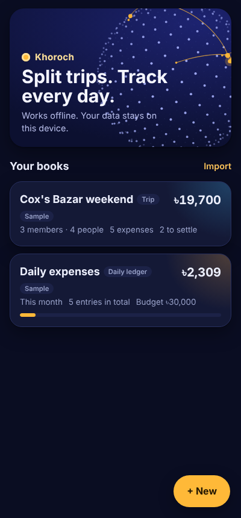
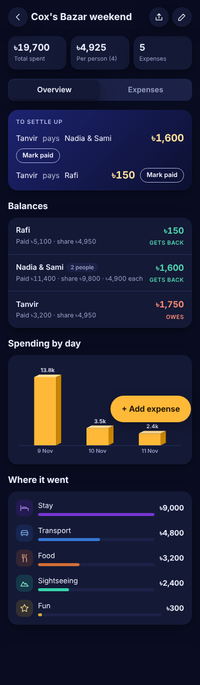
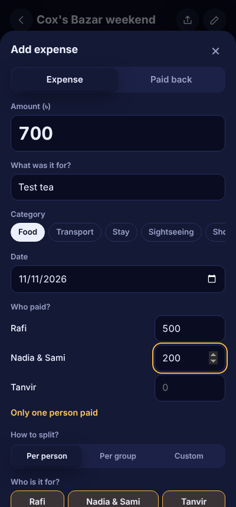
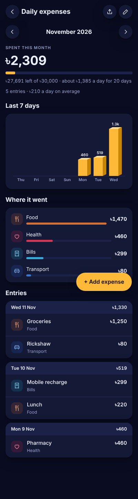

# Khoroch

**Split trip costs with friends and track your daily spending, even with no internet.**

Khoroch (খরচ, "expense" in Bangla) is a lightweight expense app that installs on your phone from the browser. Use it to keep a shared tab on a group trip, or as a personal daily ledger with a monthly budget. Everything is stored on your device. There's no account, no server and no tracking.

<p>
  
  
  
  
</p>

## Features

### Group trips
- Add each traveller, or add a couple or family as one entry with a headcount, so a group of 3 pays more than a couple.
- Split each expense **per person**, **per group** or by **custom amounts**, and include only the people it was for.
- Record **more than one payer** on a single expense, for example "SL paid 500, AG paid 80".
- **Settle up** shows the fewest payments needed to square everyone. Tap **Mark paid** when money changes hands.
- Balances show what each member paid, their fair share and the cost per person.

### Daily ledger
- Log personal spending by category: food, transport, accommodation, sightseeing, shopping, bills, health, fun and other.
- Set an optional **monthly budget** to see what's left and how much you can spend per day.
- Browse month by month, with daily totals and a category breakdown.

### Scan bills
- **Take a photo** of a bill or **upload** an image or PDF invoice when adding an expense.
- Khoroch reads the **total, date and shop name** and fills them in for you to check. If it picks the wrong total, tap the right one from the amounts it found.
- The bill photo is saved with the entry. Tap the thumbnail to view it full screen.
- Reading runs on your phone with [Tesseract.js](https://github.com/naptha/tesseract.js) (photos) and [PDF.js](https://mozilla.github.io/pdf.js/) (PDFs). The reader downloads once, about 5 MB, the first time you scan. After that it works offline.
- Works best on printed bills in English, held flat and in good light. Handwritten bills are hard to read.

### Sharing and export
- **Summary message:** totals and who pays whom, formatted for WhatsApp.
- **Trip code:** a compact code you can paste in a chat. A friend imports it into their own Khoroch with the full trip included.
- **CSV export** for Excel or Google Sheets.
- **Backup** of every book as a single code or file. Bill photos stay on the phone and aren't included.

### Design
- A 3D globe of travel routes that you can spin by dragging, cards that tilt, 3D bar charts and a coin flip when you save.
- Follows your phone's light or dark theme.
- Respects the system's reduced-motion setting.
- Supports ৳ BDT, ₹ INR, $ USD, € EUR, £ GBP, ฿ THB, RM MYR, रू NPR, AED and ¥ JPY.

## Install on Android

1. Open the hosted link in **Chrome**.
2. Tap **Install app** on the home screen, or use **⋮ menu → Add to Home screen**.
3. Open Khoroch from your app drawer. After the first visit it works fully offline.

Khoroch also runs in any modern browser on iPhone and desktop. On iPhone, use **Share → Add to Home Screen** in Safari.

## Host your own copy

Khoroch is plain static files with no build step. Any HTTPS static host works, and these are free:

| Host | How |
|---|---|
| **GitHub Pages** | Push this folder to a repository, then go to **Settings → Pages → Deploy from branch** and choose `main` / root. |
| **Netlify Drop** | Drag the folder onto [app.netlify.com/drop](https://app.netlify.com/drop). |
| **Cloudflare Pages** | **Workers & Pages → Create → Upload assets**, then drop the folder. |

The service worker needs HTTPS (or `localhost`) for offline mode and installation to work. To try it locally, run:

```bash
python3 -m http.server 8000
# open http://localhost:8000
```

### Shipping an update
Replace the files, then bump the cache name in `sw.js` (for example `khoroch-v1` → `khoroch-v2`) so installed copies pick up the new version.

### Play Store / APK
Once it's hosted, [PWABuilder](https://www.pwabuilder.com) can package the URL as an Android app (Trusted Web Activity) for the Google Play Store.

## Files

| File | Purpose |
|---|---|
| `index.html` | The whole app: markup, styles and script in one file |
| `sw.js` | Service worker that caches the app for offline use |
| `manifest.webmanifest` | Name, colours and icons used when installing |
| `icon-192.png`, `icon-512.png`, `icon-maskable-512.png` | App icons |
| `screenshots/` | Images used in this README |

## Privacy

Your data and bill photos are saved in your browser's storage on your own device. Bills are read on the phone itself, and nothing is uploaded anywhere. Clearing the browser's site data deletes it, so use **Share → Back up everything** now and then.

## Built with

Vanilla HTML, CSS and JavaScript, with no build step. Bill scanning loads Tesseract.js and PDF.js on first use. The 3D effects are drawn with Canvas 2D and CSS transforms. The fonts are [Bricolage Grotesque](https://fonts.google.com/specimen/Bricolage+Grotesque) and [Hind Siliguri](https://fonts.google.com/specimen/Hind+Siliguri) from Google Fonts, cached for offline use after the first load.
